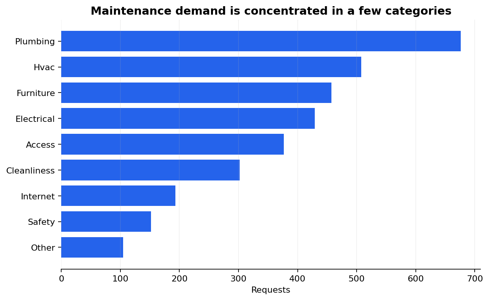
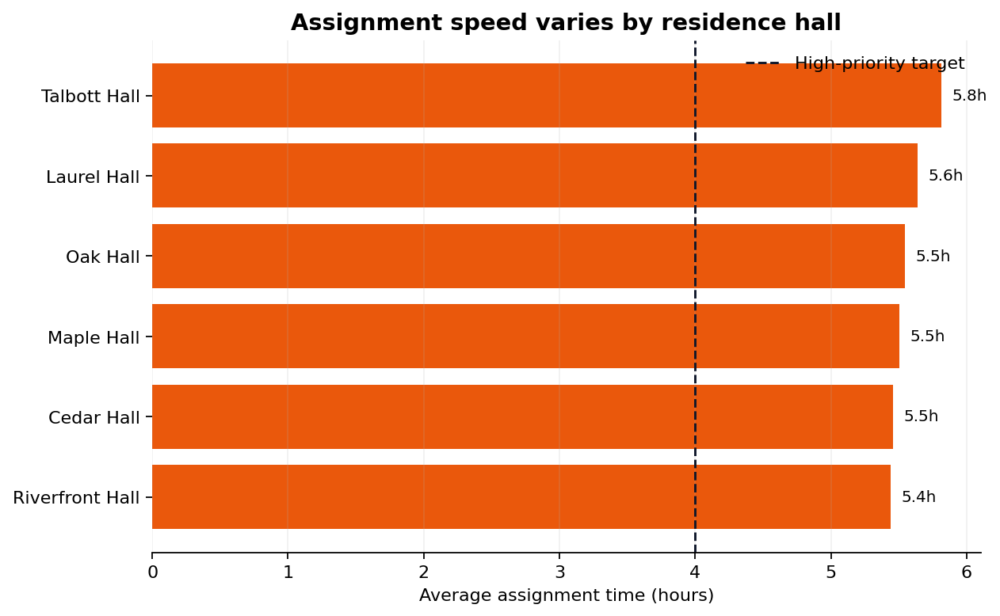

# Residence Hall Maintenance Operations Analytics


An end-to-end data analysis and process-improvement project for a fictional residence-life operations team. The project examines maintenance-request demand, routing speed, service-level performance, and recurring issues, then turns the findings into practical workflow recommendations.

> **Portfolio disclosure:** All records in this repository are synthetic and fictionalized. They do not represent official NJIT data or any real resident, building, employee, or work order.

## Business question

How can an operations team use maintenance-request data to identify recurring demand, improve routing, and reduce the time residents wait for action?

## Headline findings

The reproducible analysis produces **3,200 raw records** and **3,199 cleaned requests** after removing one duplicate request ID and standardizing text/date fields.

| KPI | Result |
| --- | ---: |
| Average assignment time | **5.58 hours** |
| Median assignment time | **5.76 hours** |
| Requests meeting assignment SLA | **87.0%** |
| Average resolution time | **22.05 hours** |
| Reopen rate | **9.8%** |
| Average satisfaction | **4.24 / 5** |
| Estimated service cost represented | **$495,161.88** |





## Recommendations

1. Create an emergency/high-priority triage queue with an owner and escalation timer.
2. Review hall-level workload and open-request counts during a weekly operations huddle.
3. Build recurring-work playbooks for high-volume categories such as plumbing, HVAC, and furniture.
4. Add required category/subcategory fields and an automated duplicate-request check to intake.
5. Track assignment SLA weekly and review reopened requests for root causes.

The scenario analysis estimates that reducing average assignment time from **5.58 hours to a 2-hour target** would represent an approximately **64.2% modeled improvement**. This is a planning scenario, not a measured operational result.

## Tools demonstrated

- **Python:** pandas, NumPy, Matplotlib
- **SQL:** KPI queries for category, hall, priority, team, and monthly performance
- **Excel:** executive summary dashboard with filters, tables, metrics, and charts
- **Business analysis:** process recommendations, requirements, user stories, and limitations
- **Quality practices:** reproducible generation, cleaning checks, tests, and GitHub Actions

## Repository map

```text
.
├── data/
│   ├── raw/maintenance_requests_raw.csv
│   ├── processed/maintenance_requests_clean.csv
│   └── README.md
├── dashboard/
│   ├── maintenance_operations_dashboard.xlsx
│   └── README.md
├── docs/
│   ├── data_dictionary.md
│   ├── process-improvement.md
│   └── project-brief.md
├── notebooks/
│   └── 01_maintenance_request_analysis.ipynb
├── reports/
│   ├── analysis_summary.md
│   ├── metrics.json
│   ├── figures/
│   └── tables/
├── sql/maintenance_kpis.sql
├── src/
│   ├── generate_data.py
│   └── analyze.py
├── tests/test_pipeline.py
├── requirements.txt
└── README.md
```

## Reproduce the project

```bash
python -m venv .venv

# Windows PowerShell
.\.venv\Scripts\Activate.ps1

# macOS/Linux
source .venv/bin/activate

pip install -r requirements.txt
python src/generate_data.py
python src/analyze.py
python -m unittest discover -s tests -v
```

The analysis script regenerates the cleaned dataset, summary tables, five PNG charts, the Markdown findings report, and the Excel dashboard.

## SQL examples

The SQL file contains portable queries for:

- category volume and service performance;
- hall-level assignment speed and open requests;
- monthly request trends;
- priority-level SLA performance;
- recurring issue types.

Load `data/processed/maintenance_requests_clean.csv` into a table named `maintenance_requests_clean` before running the queries.

## Resume-ready description

**Residence Hall Maintenance Operations Analytics | Python, SQL, Excel**

- Analyzed 3,199 cleaned synthetic maintenance requests using Python, SQL, and Excel to identify recurring issues, hall-level bottlenecks, SLA performance, and resident-service trends.
- Built a reproducible data-cleaning pipeline, KPI tables, five visualizations, and an executive Excel dashboard; recommended triage, workload balancing, and recurring-work playbooks.

## Interview explanation

“I created a synthetic maintenance-request dataset and treated it like an operations analyst would treat a real service queue. I cleaned duplicate and inconsistent records, calculated assignment and resolution KPIs, compared performance across halls and priorities, and translated the findings into process recommendations. The project helped me practice turning raw operational data into decisions—not just charts.”

## Limitations

This is a portfolio demonstration. The dataset, SLA definitions, cost estimates, and findings are synthetic. A real implementation would validate the fields and targets with the operations team and apply appropriate privacy controls.
